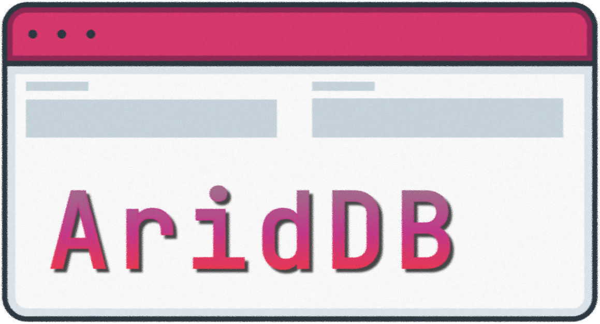

<div align="center">




A lightweight, embeddable, file-based database Written in Rust — no SQL, no server, 

[]()
[](LICENSE)
[](https://github.com/CheefLofter/AridDB/issues)
[]()
[](https://blog.rust-lang.org/2026/10/15/Rust-1.99.1/)
[](https://github.com/CheefLofter/AridDB/pulls)

</div>

---


##  About

AridDB is a simple embeddable database store that persists data
to the local file system. Instead of writing SQL or running a separate database
server, you interact with your data through clean, built-in functions —
making it ideal for small projects, prototypes, and local tooling.

##  Features

-  **Embeddable** — the database lives inside your project; nothing to install or run
-  **File-based** — data persists as plain files on your local file system
-  **No SQL** — store and retrieve data with simple, readable method calls
-  **Auto-indexing** — rows receive auto-generated indexes out of the box
-  **Lightweight** — a minimal, readable codebase you can fully understand

## Quick Start


```rust

// initialization and defining schema
let db = Database::new(
        "example",
        vec![
            SchemaType::Integer,
            SchemaType::String, 
            SchemaType::Boolean],
    );
   
    // push single row
     match db.push_one(       
        serde_json::json!([1, "Hello", true])
    ){
        Ok(msg) => println!("Push one result: {}", msg),
        Err(e) => println!("Error: {}", e),
     }
     // pushing multiple rows to the db
     match db.push_many(&[
        serde_json::json!([2, "World", false]),
        serde_json::json!([3, "Rust", true])
    ]){
        Ok(msg) => println!("Push many result: {}", msg),
        Err(e) => println!("Error: {}", e),
    }
    // geting a single row
    match db.get_one(1) {
        Ok(row) => println!("Get one result: {}", row),
        Err(e) => println!("Error: {}", e),
    }
    // geting a range of rows
    match db.get_many(1, 3) {
        Ok(rows) => {
            println!("Get many result:");
            for row in rows {
                println!("{}", row);
            }
        },
        Err(e) => println!("Error: {}", e),
    }
    // dumping entire db
    match db.dump() {
        Ok(rows) => {
            println!("Dump result:");
            for row in rows {
                println!("{}", row);
            }
        },
        Err(e) => println!("Error: {}", e),
    }


```

Initializing a database or a kvstore will create a .dbsuff/.kvstuff file in the same directory 
It will also check for existing files and will use them if posible 


## Roadmap

- add a key value system instead of number indexing
- add ability to make a schema less db


## License

Distributed under the [MIT License](LICENSE). See `LICENSE` for more information.

